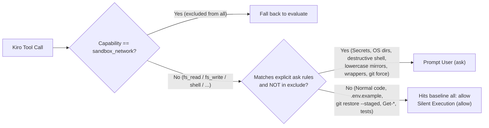

<div align="center">

# ⚡ Kiro Windows Autonomy

<p>
  <b>规则驱动的 Kiro IDE 用户级权限护栏 · Windows 11 / PowerShell 工程规范 · 自动化回归测试套件</b>
</p>
<p>
  <i>告别概率弹窗疲劳，日常开发零打扰放行，关键凭据、系统目录与高危操作精准确认</i>
</p>

<p>
  <b>简体中文</b> | <a href="./README_EN.md"><b>English</b></a>
</p>

<p>
  <a href="https://github.com/YOIMIYA66/kiro-windows-autonomy/actions/workflows/ci.yml"></a>
  <a href="./LICENSE"></a>
  <a href="https://github.com/YOIMIYA66/kiro-windows-autonomy"></a>
  <a href="https://github.com/YOIMIYA66/kiro-windows-autonomy"></a>
  <a href="./tests/test_permissions.py"></a>
  <a href="https://github.com/YOIMIYA66/AI-Net-Guard"></a>
</p>

</div>

---

> [!IMPORTANT]
> **定位说明**：本配置是**防误操作的便利性护栏（convenience guardrail）**，而非系统级安全沙箱或硬隔离边界。系统层网络隔离与防泄露请搭配操作系统权限控制或内核防火墙（如 [AI-Net-Guard](https://github.com/YOIMIYA66/AI-Net-Guard)）使用。

---

## 🚀 一键安装 (AI Agent Prompt)

如果你正在使用 **Kiro**（或其他具备终端/文件操作能力的 AI 编程助手），可以直接点击右上角复制下方提示词发给 AI，让它自动完成**备份原有配置 → 拉取本仓库 → 按你本机工具链定制 → 语法与测试校验**：

```text
请帮我安装并适配 https://github.com/YOIMIYA66/kiro-windows-autonomy 仓库中的 Kiro Windows 配置，按以下顺序执行：

1. 先备份我现有的 `%USERPROFILE%\.kiro\settings` 和 `%USERPROFILE%\.kiro\steering`（如果存在），备份目录命名为 `.bak-YYYYMMDD` 并告诉我回滚方式。
2. 将 `https://github.com/YOIMIYA66/kiro-windows-autonomy.git` 克隆到临时目录（例如 `%USERPROFILE%\.kiro\_upstream-kiro-windows-autonomy`）。
3. 复制 `settings/permissions.yaml` 到 `%USERPROFILE%\.kiro\settings\permissions.yaml`：
   - 保留所有默认护栏规则。
   - 检查我本机是否有需要额外保护的目录（例如防火墙/代理脚本目录），先向我确认后再取消注释或添加到 `fs_write` 规则中。
4. 复制 `steering/*.md` 到 `%USERPROFILE%\.kiro\steering\`：
   - 检测我本机实际安装的工具链（Git、Go、Python/uv/conda、Node.js/pnpm、.NET、Java、PSScriptAnalyzer 等版本与路径）和当前代理设置，据此定制 `steering/windows-environment.md`（不要把未安装的软件写进去，也不要泄露或写入任何密钥/节点/订阅数据）。
   - 检查 `steering/personal-preferences.md` 是否符合我的回复语言偏好。
5. 如果我使用了 `mcp.json` 或需要忽略本地敏感数据库，向我说明如何参考 `settings/kiroignore.example` 和 `settings/mcp.example.json`（注意 `${CONTEXT7_API_KEY}` 等环境变量首次使用会在 Kiro 中触发审批提示）。
6. 在仓库目录运行 `python -B -m unittest discover -s tests -v`（如缺少 PyYAML 请先询问我或使用虚拟环境），并对安装后的 `%USERPROFILE%\.kiro\settings\permissions.yaml` 做一次 YAML 语法校验，最后向我汇报：备份位置、修改/复制了哪些文件、测试与校验结果。
```

---

## 💡 核心痛点与对比 (Why Kiro Windows Autonomy)

在 Windows 11 下使用 Kiro 进行日常高频开发时，默认策略与通用 prompt 往往会遇到四类典型摩擦。本仓库的对比收益如下：

| 维度 | 默认 `approve-for-me` / 无 Windows 规范 | 使用 **Kiro Windows Autonomy** 后 |
| :--- | :--- | :--- |
| **日常开发流** | 概率分类器（`evaluate`）在构建、只读排查或连续改文件时频繁弹出确认，打断心流 | 基线 `capability: all -> allow`（不含 `sandbox_network`）让**只读查询与常规开发零打扰放行**，仅高危动作刹车 |
| **凭据与 OS 保护** | 依赖模型/分类器临时判断，`.env`、SSH 私钥、GitHub CLI Token 等边界不透明 | `fs_read` + `fs_write` **双层显式 `ask` 清单**守护密钥、凭据、Windows 系统目录与可选服务目录 |
| **PowerShell 大小写陷阱** | Kiro 的 `shell` 规则区分大小写；配置 `Set-Acl *` 会被全小写 `set-acl` 静默穿过 | 内置常用高危 PowerShell Cmdlet 的**全小写镜像**与 `cmd /c` / `/C` / `/k` / `/K` 规则，**缓解已知全小写绕过** |
| **PS 5.1/7 与中文编码** | AI 常写出仅 PS 7 支持的 `??`/`&&` 或无 BOM 中文 `.ps1`，在中文 Windows CP936 下直接乱码报错 | Steering 强制兼容 **PS 5.1**、明确 **UTF-8 BOM / ASCII `.bat` CRLF** 规范，并要求运行 `PSScriptAnalyzer` |
| **网络排障误操作** | 下载超时或连不上 GitHub 时，AI 常“好心”去改防火墙、DNS、路由表、hosts 或镜像源 | `windows-environment.md` + `shell` 拦截双保险，**只读网络命令静默放行，写操作一律拦停汇报** |
| **规则可维护性** | 手改数百行 YAML 后无法确认是否写错 glob 导致护栏静默失效 | 自带 `unittest` **9 项回归测试 + GitHub Actions CI**，每次改动自动校验规则命中率 |

---

## 📐 权限决策流与架构 (Architecture)

Kiro 对每次工具调用按 **`deny > ask > allow > evaluate`** 的优先级求值。本配置通过基线放行接管 `evaluate`，让确定性的 `ask` 规则成为可控护栏：



> [!WARNING]
> **关于大小写敏感与静态匹配局限（必读）**
>
> 1. **缓解已知全小写绕过，但非绝对穷举**：实测 Kiro 的 `shell` 匹配区分大小写，而 PowerShell 与 `cmd` 不区分大小写。[`settings/permissions.yaml`](settings/permissions.yaml) 末尾镜像了常见 PowerShell Cmdlet 的全小写写法与 `cmd /C`、`/K` 变体，用来缓解常规全小写绕过；但无法穷举所有任意混合大小写组合（如 `sEt-aCl`、`CmD /c`）。
> 2. **脚本与变量间接传参不可见**：规则仅匹配命令行文本本身，无法审计 `.ps1` / `.bat` / `.py` 脚本内部逻辑、全路径/别名调用，或通过变量拼接传递的参数（`$k = 'HKLM:\...'; Set-Acl $k`）。
> 3. **明确排除项**：按 [Kiro 官方权限文档](https://kiro.dev/docs/permissions/)，`capability: all` **不包含 `sandbox_network`**。

---

## 🛡️ 三维防护规则矩阵 (Guardrail Matrix)

| 能力维度 | 保护类别 | 典型拦截目标 (`effect: ask`) | 静默放行例外 (`exclude` / `allow`) |
| :--- | :--- | :--- | :--- |
| **`fs_read`** | 密钥与云/Git 凭据 | `~/.ssh/**`、`~/.aws/**`、`~/.kube/**`、`~/.docker/config.json`、`**/.env`、`**/.env.*`、`**/*.pem\|key\|pfx\|p12`、`**/.git-credentials`、`~/AppData/Roaming/GitHub CLI/**`、`~/.config/gh/**` | `**/.env.example`、常规源码与文档 |
| **`fs_write`** | 凭据、OS 目录与自定义服务 | 以上全部凭据路径 + `~/.gitconfig`、`C:/Windows/**`、`C:/Program Files/**`、`C:/Program Files (x86)/**`、`C:/ProgramData/**`（支持按需取消注释 `C:/AI-Net-Guard/**`） | `**/.env.example`、项目工作区源码（可放开如 `logs/**`） |
| **`shell`** | 文件删除与磁盘启动 | `rm` / `del` / `erase` / `rd` / `Remove-Item` / `remove-item` / `Clear-RecycleBin` / `robocopy * /MIR\|/PURGE`、`format` / `diskpart` / `bcdedit` / `shutdown` | 普通文件查看、编译与测试运行 |
| **`shell`** | 注册表、ACL、服务与计划任务 | `reg add\|delete\|import\|restore`、`Set-Acl` / `set-acl` / `icacls` / `takeown`、`sc` / `Set-Service` / `Stop-Service` / `schtasks /delete\|/change` | 只读查询（`reg query`、`Get-Service`、`Get-Acl`） |
| **`shell`** | 防火墙、DNS、路由与代理 | `New-NetFirewallRule` / `Set-NetFirewallRule` / `netsh advfirewall`、`Set-DnsClient*` / `New-NetRoute` / `Set-NetAdapter` / `netsh int\|winhttp set`（均含小写镜像） | 只读诊断（`Get-NetFirewallRule`、`netsh ... show`） |
| **`shell`** | 危险 Git 与包发布 | `git reset --hard`、`git clean`、`git push --force\|-f\|--mirror\|--delete`、`git branch -D`、`git restore`（含 `--worktree`）、`npm publish`、`gh repo delete` | `git restore --staged *`、`git status` / `diff` / `commit` |
| **`shell`** | 进程终止、提权与内联包装 | `taskkill` / `Stop-Process` / `stop-process`、`Start-Process *RunAs*`、`powershell` / `pwsh`（`-Command` / `-c` / `-EncodedCommand` / `-enc`）、`cmd`（`/c` / `/C` / `/k` / `/K`） | 直接在当前 `pwsh` 会话执行的常规命令 |

---

## 🧭 Steering 工程规范 (Steering Rules)

[`steering/`](steering/) 中的四份规范共同约束 AI 在 Windows 下的编码、排障与交付质量：

| 规范文件 | 加载策略 (`inclusion`) | 核心约束亮点 |
| :--- | :--- | :--- |
| [`engineering-principles.md`](steering/engineering-principles.md) | `always` | **先复现取证再改代码**；严禁空 `catch {}` / `except: pass` / 无故 `2>$null` 吞错；禁止改测试凑通过；替换配置/二进制前先备份可回滚；Git 禁止直推 `main` 与提交密钥 |
| [`powershell-and-batch.md`](steering/powershell-and-batch.md) | `fileMatch` (`*.ps1`, `*.bat` 等) | **强制兼容 Windows PowerShell 5.1**（禁用 `??`、`&&`、`-Encoding utf8NoBOM`）；明确 `.ps1` 中文需 UTF-8 with BOM、`.bat` 需纯 ASCII + CRLF；每次改完 `.ps1` 必跑 `Parser::ParseFile` 与 `PSScriptAnalyzer` |
| [`windows-environment.md`](steering/windows-environment.md) | `always` | **禁止把命令包进 `pwsh -Command` / `cmd /c`**（避免触发无意义的包装器审批弹窗）；解释中文终端 CP936 (GBK) 乱码排查方式；划定工具链版本来源、防火墙与代理目录只读边界 |
| [`personal-preferences.md`](steering/personal-preferences.md) | `always` | **默认简体中文回复**（保留代码、命令、路径与报错原文）；修改 ≥3 个文件或涉及架构/系统设置前先出方案；禁止顺手重构；结项必报改动、验证命令与未验证项 |

<details>
<summary>📋 查看 <code>powershell-and-batch.md</code> 内置的 PowerShell 脚本自动验收命令</summary>

```powershell
# 1. 语法解析检查
$errs = $null
[void][System.Management.Automation.Language.Parser]::ParseFile('<file>', [ref]$null, [ref]$errs)
$errs

# 2. Lint 与 PowerShell 5.1 / 7.0 双版本语法兼容性校验
Invoke-ScriptAnalyzer -Path '<file>' -Severity Warning,Error
Invoke-ScriptAnalyzer -Path '<file>' -Settings @{
    IncludeRules = @('PSUseCompatibleSyntax')
    Rules = @{ PSUseCompatibleSyntax = @{ Enable = $true; TargetVersions = @('5.1', '7.0') } }
}
```

</details>

---

## 🛡️ 纵深防御搭档：[AI-Net-Guard](https://github.com/YOIMIYA66/AI-Net-Guard)

因为 `permissions.yaml` 仅属于 Kiro 应用层的命令文本护栏，如果你在 Windows 11 上使用各类 AI 编程工具并搭配 TUN 代理，建议配合我的另一个开源项目在内核层建立真实的网络边界：

> **[YOIMIYA66/AI-Net-Guard](https://github.com/YOIMIYA66/AI-Net-Guard)** — *Zero-resident Windows 11 kernel WFP static firewall & DNS leak shield for AI coding tools and TUN proxies (Xray / sing-box / Hysteria2 / Mihomo)*

| 防护层级 | 负责组件 | 防护目标 |
| :--- | :--- | :--- |
| **应用层护栏** | **Kiro Windows Autonomy** (`permissions.yaml` + `steering/`) | 阻止 AI 误读密钥、误删文件或擅自执行 `New-NetFirewallRule` / `Set-DnsClient*` / 修改 `C:/AI-Net-Guard/**` |
| **内核层隔离** | **[AI-Net-Guard](https://github.com/YOIMIYA66/AI-Net-Guard)** (Windows 11 WFP) | 零内存驻留内核静态防火墙，阻断 TUN 崩溃回退直连、SMHNR DNS 泄露与未授权出站 |

联动开启方式：在 [`settings/permissions.yaml`](settings/permissions.yaml) 的 `fs_write` 中取消注释即可保护其部署目录（并按需放开 `logs/**`）：

```yaml
      # Optional: Protect network guard & proxy runtime directories
      # (e.g. if using https://github.com/YOIMIYA66/AI-Net-Guard)
      - "C:/AI-Net-Guard/**"
    exclude:
      - "**/.env.example"
      - "C:/AI-Net-Guard/logs/**"
```

---

## 📦 分步手动安装指南 (Manual Installation)

> [!TIP]
> 在覆盖之前，建议先对原有的 `%USERPROFILE%\.kiro\settings` 和 `%USERPROFILE%\.kiro\steering` 做时间戳备份。

### 第 1 步：备份原有配置并克隆仓库

```powershell
$kiroDir = "$env:USERPROFILE\.kiro"
$stamp = Get-Date -Format "yyyyMMdd-HHmmss"
if (Test-Path "$kiroDir\settings") { Copy-Item -Recurse "$kiroDir\settings" "$kiroDir\settings.bak-$stamp" }
if (Test-Path "$kiroDir\steering") { Copy-Item -Recurse "$kiroDir\steering" "$kiroDir\steering.bak-$stamp" }

git clone https://github.com/YOIMIYA66/kiro-windows-autonomy.git
cd kiro-windows-autonomy
```

### 第 2 步：安装 `permissions.yaml`

```powershell
New-Item -ItemType Directory -Force -Path "$env:USERPROFILE\.kiro\settings" | Out-Null
Copy-Item .\settings\permissions.yaml "$env:USERPROFILE\.kiro\settings\permissions.yaml"
```

*(可选)* 打开 `%USERPROFILE%\.kiro\settings\permissions.yaml`，根据你本机实际目录取消注释或新增受保护路径（如 `C:/AI-Net-Guard/**` 或本地代理软件配置目录）。

### 第 3 步：安装并定制 `steering/` 规范

```powershell
New-Item -ItemType Directory -Force -Path "$env:USERPROFILE\.kiro\steering" | Out-Null
Copy-Item .\steering\*.md "$env:USERPROFILE\.kiro\steering\"
```

建议按需修改以下两份模板以匹配你的机器：
- `%USERPROFILE%\.kiro\steering\windows-environment.md`：更新 `## Toolchain`（你的实际语言版本与包管理器）和 `## Protected locations`。
- `%USERPROFILE%\.kiro\steering\personal-preferences.md`：调整回复语言（默认简体中文）或汇报格式偏好。

### 第 4 步：*(可选)* 配置忽略清单与 MCP 环境变量

参考 [`settings/kiroignore.example`](settings/kiroignore.example) 与 [`settings/mcp.example.json`](settings/mcp.example.json)：

> [!NOTE]
> [`settings/mcp.example.json`](settings/mcp.example.json) 使用了 `${CONTEXT7_API_KEY}` 变量展开。请先在系统/用户环境变量中设置 `CONTEXT7_API_KEY`；**首次使用未批准的环境变量时，Kiro 会弹出安全确认提示**，在弹窗中点击批准后即可正常使用。

---

## 📂 仓库目录索引

| 路径 | 类型 | 说明 |
| :--- | :--- | :--- |
| [`settings/permissions.yaml`](settings/permissions.yaml) | 核心配置 | Kiro 用户级规则驱动权限策略（`all: allow` + `fs_read` / `fs_write` / `shell` `ask` 清单） |
| [`settings/kiroignore.example`](settings/kiroignore.example) | 参考模板 | 屏蔽代理节点数据库（`guiNDB.db*`）与本地证书密钥文件 |
| [`settings/mcp.example.json`](settings/mcp.example.json) | 参考模板 | 使用 `${CONTEXT7_API_KEY}` 环境变量鉴权的 MCP 示例 |
| [`steering/engineering-principles.md`](steering/engineering-principles.md) | Steering | 通用工程诊断、错误处理、Git 与安全准则 |
| [`steering/powershell-and-batch.md`](steering/powershell-and-batch.md) | Steering | PowerShell 5.1 兼容性、BOM / CP936 编码与校验规范 |
| [`steering/windows-environment.md`](steering/windows-environment.md) | Steering | Windows 11 + `pwsh` 环境约束与只读边界模板 |
| [`steering/personal-preferences.md`](steering/personal-preferences.md) | Steering | 回复语言、Plan-First 阈值与结项报告格式 |
| [`tests/test_permissions.py`](tests/test_permissions.py) | 回归测试 | 验证 YAML 结构、`sandbox_network` 排除、凭据对称性与高危命令匹配 |
| [`.github/workflows/ci.yml`](.github/workflows/ci.yml) | CI 工作流 | 每次 push / PR 至 `main` 自动执行回归测试 |

---

## 🧪 规则校验与回归测试 (Regression Tests)

每次增删或修改 `permissions.yaml` 后，建议运行自动化回归测试（依赖 `PyYAML`）：

```powershell
python -m pip install pyyaml
python -B -m unittest discover -s tests -v
```

测试脚本 [`tests/test_permissions.py`](tests/test_permissions.py) 按 `deny > ask > allow > evaluate` 与大小写敏感 glob 语义验证：
- YAML 语法与 `approve-for-me` 基线策略完整性；
- `capability: all` 正确排除 `sandbox_network`；
- `fs_read` 与 `fs_write` 对 `.ssh` / `.aws` / `.kube` / `.env` / GitHub CLI 等凭据保护的一致性；
- PowerShell 常见全小写镜像、`cmd /c` & `/C` 包装命令、`git` 破坏性命令放行/拦截边界，以及已知 Kiro 限制文档一致性。

---

<div align="center">

**[MIT License](LICENSE)** © 2026 [YOIMIYA66](https://github.com/YOIMIYA66)

如果这个配置帮你减少了 Kiro 的弹窗干扰，欢迎点个 ⭐ Star，也欢迎搭配 [AI-Net-Guard](https://github.com/YOIMIYA66/AI-Net-Guard) 一起使用！

</div>
