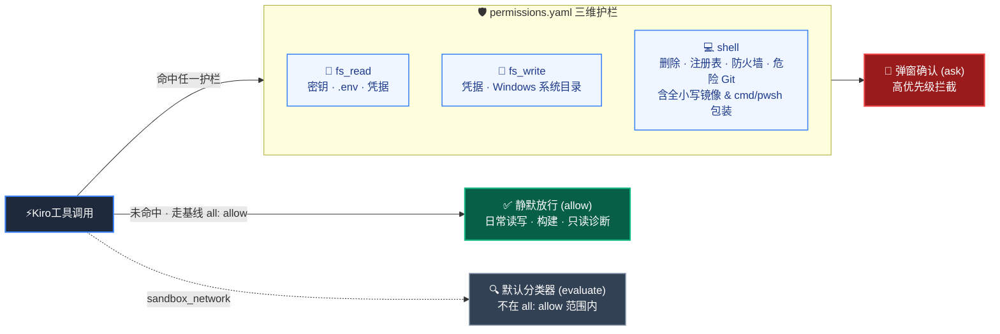

<div align="center">

# ⚡ Kiro Windows Autonomy

<p>
  <b>规则驱动的 Kiro IDE 用户级权限护栏 · Windows 11 / PowerShell 工程规范 · 自动化回归测试套件</b>
</p>
<p>
  <i>告别概率弹窗疲劳，日常开发零打扰放行，关键凭据、系统目录与高危操作精准确认</i>
</p>

<p>
  <b>简体中文</b> | <a href="./README_EN.md"><b>English</b></a>
</p>

<p>
  <a href="https://github.com/YOIMIYA66/kiro-windows-autonomy/actions/workflows/ci.yml"></a>
  <a href="./LICENSE"></a>
  <a href="https://github.com/YOIMIYA66/kiro-windows-autonomy"></a>
  <a href="https://github.com/YOIMIYA66/kiro-windows-autonomy"></a>
  <a href="./tests/test_permissions.py"></a>
  <a href="https://github.com/YOIMIYA66/AI-Net-Guard"></a>
</p>

</div>

---

> [!IMPORTANT]
> **定位说明**：本配置是**防误操作的便利性护栏（convenience guardrail）**，而非系统级安全沙箱或硬隔离边界。系统层网络隔离请搭配操作系统权限或内核防火墙（如 [AI-Net-Guard](https://github.com/YOIMIYA66/AI-Net-Guard)）。

---

## 🚀 一键安装：复制给 AI 自动部署

如果你正在使用 **Kiro**（或其他本地 AI 编程助手），直接复制下方提示词发给它，即可自动完成**备份原有配置 → 拉取仓库 → 按本机环境定制 → 校验测试**：

```text
请帮我安装并适配 https://github.com/YOIMIYA66/kiro-windows-autonomy 的 Kiro Windows 配置：
1. 先将我现有的 `%USERPROFILE%\.kiro\settings` 和 `steering` 备份为 `.bak-YYYYMMDD`。
2. 克隆该仓库，安装 `settings/permissions.yaml` 和 `steering/*.md` 到 `%USERPROFILE%\.kiro\`。
3. 检测我本机实际安装的工具链（Git/Go/Python/Node 等）并定制 `windows-environment.md`（勿写入密钥或缺失工具），向我确认是否需要保护特定服务目录及回复语言偏好；如用到 MCP，提醒我 `${CONTEXT7_API_KEY}` 的首次审批提示。
4. 运行 `python -B -m unittest discover -s tests -v` 并校验安装后的 YAML 语法，最后向我汇报备份路径、改动文件与测试结果。
```

---

## 💡 核心优势

| 痛点 | 默认行为 | 使用 **Kiro Windows Autonomy** 后 |
| :--- | :--- | :--- |
| **弹窗打断** | 概率分类器（`evaluate`）频繁打断构建与只读排查 | 基线 `all: allow` 让**日常开发与只读查询零打扰放行**，仅高危动作确认 |
| **凭据边界** | 敏感文件与系统目录边界不透明 | `fs_read` + `fs_write` **显式 `ask` 清单**守护密钥、Token 与 OS 目录 |
| **大小写绕过** | `shell` 规则区分大小写，`Set-Acl *` 漏掉小写 `set-acl` | 内置常用 PowerShell **全小写镜像**与 `cmd /c` / `/C` 拦截，缓解已知绕过 |
| **Windows 编码/语法** | AI 写出 PS 7 语法或无 BOM 中文脚本，CP936 下乱码报错 | 强制兼容 **PS 5.1**、**UTF-8 BOM / ASCII `.bat`**，并跑 `PSScriptAnalyzer` |
| **规则可维护** | 手改 YAML 后无法验证护栏是否悄然失效 | 自带 **9 项 `unittest` 回归测试 + GitHub Actions CI** 自动守护 |

---

## 📐 权限工作原理

Kiro 按 **`deny > ask > allow > evaluate`** 优先级裁决工具调用。本配置在基线放行所有常规动作的同时，用显式 `ask` 清单拦截高危操作：



### ⚡ 实际效果速览

```powershell
# ✅ 全程静默执行（零弹窗打扰）
git status; git diff; git restore --staged .
go test ./...; pytest; Get-NetFirewallRule

# 🛑 自动刹车并弹窗确认（ask）
cat ~/.ssh/id_ed25519        # 读取敏感私钥
remove-item -recurse ./src   # 删除文件（含全小写绕过缓解）
git reset --hard HEAD~1      # 抹除工作区历史
cmd /C "del /f /q *"         # 内联解释器包装调用
```

---

## 🛡️ 拦截了什么？

| 能力维度 | 弹窗确认 (`ask`) | 静默放行 (`allow` / `exclude`) |
| :--- | :--- | :--- |
| **读取凭据 (`fs_read`)** | SSH / AWS / Kube / Docker 凭据、`.env`、私钥证书（`.pem` / `.key` / `.pfx` / `.p12`）、Git 与 GitHub CLI 凭据 | `.env.example`、常规项目源码与文档 |
| **写入系统 (`fs_write`)** | 上述全部凭据、`~/.gitconfig`、`C:/Windows`、`Program Files`、`ProgramData`（及可选保护目录） | `.env.example`、项目工作区源码（可按需放开 `logs/**`） |
| **高危命令 (`shell`)** | 文件销毁（`rm` / `Remove-Item` / `robocopy /MIR`）、磁盘与关机、注册表/ACL（`Set-Acl` / `icacls`）、服务与防火墙/DNS/路由修改（含常见小写镜像） | `Get-*`、`netsh ... show`、`reg query` 等只读诊断及编译测试 |
| **Git 与包装 (`shell`)** | `git reset --hard` / `clean` / `push --force` / `restore --worktree`、`taskkill` / `Stop-Process`、`RunAs` 提权、`powershell -Command/-EncodedCommand`、`cmd /c` & `/C` | `git restore --staged *`、`git status` / `diff` / `commit` |

> [!WARNING]
> **边界与局限（非安全沙箱）**
> - **大小写限制**：全小写镜像仅用于**缓解已知的全小写绕过**；由于 Kiro 的匹配器区分大小写，任意混合大小写（如 `sEt-aCl`、`CmD /c`）仍可能留下变体。
> - **静态文本匹配**：仅检查命令字符串本身，无法审计 `.ps1` / `.bat` / `.py` 脚本内部、全路径/别名调用或变量间接传参（如 `Set-Acl $k`）。
> - **网络隔离独立**：按 [Kiro 官方权限文档](https://kiro.dev/docs/permissions/)，`capability: all` **不包含 `sandbox_network`**。

---

## 🧭 Steering 工程规范

[`steering/`](steering/) 中的四份规范共同约束 AI 在 Windows 下的编码、排障与交付习惯：

| 规范文件 | 生效方式 | 核心规范 |
| :--- | :--- | :--- |
| [`engineering-principles.md`](steering/engineering-principles.md) | `always` | 先复现取证再修 Bug；禁止空 `catch {}` / `2>$null` 吞错；禁止改测试凑通过；改动系统配置先备份 |
| [`powershell-and-batch.md`](steering/powershell-and-batch.md) | `*.ps1` / `*.bat` | 默认兼容 **PowerShell 5.1**；规范 `.ps1` UTF-8 BOM 与 `.bat` ASCII+CRLF；每次改动运行 `PSScriptAnalyzer` |
| [`windows-environment.md`](steering/windows-environment.md) | `always` | 禁止用 `pwsh -Command` / `cmd /c` 包装命令（避免弹窗）；CP936 乱码排查；防火墙与代理目录只读红线 |
| [`personal-preferences.md`](steering/personal-preferences.md) | `always` | 简体中文回复（保留原路径与代码）；改动 ≥3 个文件或系统设置前先给方案；结项附验证命令与结果 |

<details>
<summary>📋 查看 <code>powershell-and-batch.md</code> 内置的 PowerShell 脚本校验命令</summary>

```powershell
# 1. 语法解析检查
$errs = $null
[void][System.Management.Automation.Language.Parser]::ParseFile('<file>', [ref]$null, [ref]$errs)
$errs

# 2. Lint 与 PowerShell 5.1 / 7.0 双版本语法兼容性校验
Invoke-ScriptAnalyzer -Path '<file>' -Severity Warning,Error
Invoke-ScriptAnalyzer -Path '<file>' -Settings @{
    IncludeRules = @('PSUseCompatibleSyntax')
    Rules = @{ PSUseCompatibleSyntax = @{ Enable = $true; TargetVersions = @('5.1', '7.0') } }
}
```

</details>

---

## 🛡️ 搭配 AI-Net-Guard 实现内核级网络保护

因为 `permissions.yaml` 只管应用层命令文本，在 Windows 11 上搭配 TUN 代理时，推荐与我的另一个开源项目 **[AI-Net-Guard](https://github.com/YOIMIYA66/AI-Net-Guard)**（零驻留 Windows 11 内核 WFP 静态防火墙 & DNS/IPv6 防泄漏盾）配合使用。

只需在 [`settings/permissions.yaml`](settings/permissions.yaml) 的 `fs_write` 中取消注释其路径，即可防止 AI 在排障时擅自改写你的防火墙脚本与策略：

```yaml
      # Optional: Protect network guard & proxy runtime directories
      # (e.g. if using https://github.com/YOIMIYA66/AI-Net-Guard)
      - "C:/AI-Net-Guard/**"
    exclude:
      - "**/.env.example"
      - "C:/AI-Net-Guard/logs/**"
```

---

## 📦 手动安装

> [!TIP]
> 覆盖前脚本会自动将你原有的 `settings` 与 `steering` 目录按时间戳备份到 `.bak-*`。

```powershell
# 1. 备份原有配置
$kiroDir = "$env:USERPROFILE\.kiro"
$stamp = Get-Date -Format "yyyyMMdd-HHmmss"
if (Test-Path "$kiroDir\settings") { Copy-Item -Recurse "$kiroDir\settings" "$kiroDir\settings.bak-$stamp" }
if (Test-Path "$kiroDir\steering") { Copy-Item -Recurse "$kiroDir\steering" "$kiroDir\steering.bak-$stamp" }

# 2. 克隆仓库并安装 permissions.yaml 与 steering 规范
git clone https://github.com/YOIMIYA66/kiro-windows-autonomy.git
cd kiro-windows-autonomy
New-Item -ItemType Directory -Force -Path "$kiroDir\settings", "$kiroDir\steering" | Out-Null
Copy-Item .\settings\permissions.yaml "$kiroDir\settings\permissions.yaml"
Copy-Item .\steering\*.md "$kiroDir\steering\"
```

安装后建议按本机实际情况微调两处：
- **定制环境信息**：修改 `%USERPROFILE%\.kiro\steering\windows-environment.md` 中的 `## Toolchain` 与 `## Protected locations`，并在 `permissions.yaml` 中按需取消注释受保护服务目录。
- **配置 MCP（可选）**：如参考 [`settings/mcp.example.json`](settings/mcp.example.json) 使用 `${CONTEXT7_API_KEY}`，请先在环境变量中配置该 Key；**首次引用未批准的环境变量时，Kiro 会弹出安全确认提示，点击批准即可**。本地敏感数据库屏蔽可参考 [`settings/kiroignore.example`](settings/kiroignore.example)。

---

## 📂 目录结构与回归测试

```text
.
├── .github/workflows/ci.yml           # GitHub Actions 回归测试 CI
├── settings/
│   ├── permissions.yaml               # Kiro 用户级权限策略（核心）
│   ├── kiroignore.example             # 代理节点数据库 / 证书密钥忽略模板
│   └── mcp.example.json               # 使用环境变量鉴权的 MCP 配置示例
├── steering/                          # Windows / PowerShell / 工程与交互规范
└── tests/test_permissions.py          # 权限规则匹配与语法回归测试（9 项用例）
```

修改 `permissions.yaml` 后运行自动化校验（依赖 `PyYAML`）：

```powershell
python -m pip install pyyaml
python -B -m unittest discover -s tests -v
```

---

<div align="center">

**[MIT License](LICENSE)** © 2026 [YOIMIYA66](https://github.com/YOIMIYA66)

如果这个配置帮你减少了 Kiro 的弹窗干扰，欢迎点个 ⭐ Star，也欢迎搭配 [AI-Net-Guard](https://github.com/YOIMIYA66/AI-Net-Guard) 一起使用！

</div>
