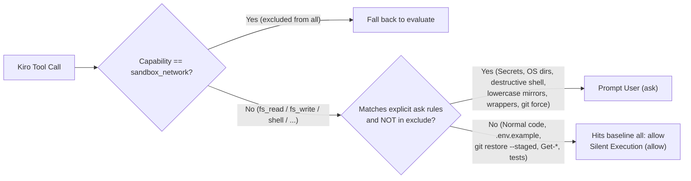

<div align="center">

# ⚡ Kiro Windows Autonomy

<p>
  <b>Rule-Driven User Permissions for Kiro IDE · Windows 11 / PowerShell Steering Ruleset · Automated Regression Suite</b>
</p>
<p>
  <i>Eliminate prompt fatigue on routine builds and read-only checks while guarding credentials, OS directories, and destructive commands</i>
</p>

<p>
  <a href="./README.md"><b>简体中文</b></a> | <b>English</b>
</p>

<p>
  <a href="https://github.com/YOIMIYA66/kiro-windows-autonomy/actions/workflows/ci.yml"></a>
  <a href="./LICENSE"></a>
  <a href="https://github.com/YOIMIYA66/kiro-windows-autonomy"></a>
  <a href="https://github.com/YOIMIYA66/kiro-windows-autonomy"></a>
  <a href="./tests/test_permissions.py"></a>
  <a href="https://github.com/YOIMIYA66/AI-Net-Guard"></a>
</p>

<p>
  <a href="#-one-shot-ai-setup-prompt">🚀 AI Setup Prompt</a> •
  <a href="#-why-kiro-windows-autonomy">💡 Why This Repo</a> •
  <a href="#-permission-flow--architecture">📐 Flow & Architecture</a> •
  <a href="#-three-layer-guardrail-matrix">🛡️ Guardrail Matrix</a> •
  <a href="#-steering-rules">🧭 Steering Rules</a> •
  <a href="#-manual-installation">📦 Manual Install</a> •
  <a href="#-verification--regression-tests">🧪 Regression Tests</a>
</p>

</div>

---

> [!IMPORTANT]
> **Scope & Intent**: This configuration is a **convenience guardrail against accidental agent actions**, NOT a security sandbox or an OS-level security boundary. Pair it with OS permissions and kernel-level network isolation (such as [AI-Net-Guard](https://github.com/YOIMIYA66/AI-Net-Guard)) for real security boundaries.

---

## 🚀 One-Shot AI Setup Prompt

Already using **Kiro** (or another coding agent with terminal/file access)? Click copy on the prompt below and send it to your agent to **back up your existing `~/.kiro` setup → pull this repository → tailor it to your installed toolchain → verify YAML and tests**:

```text
Please install and adapt the Kiro Windows configuration from https://github.com/YOIMIYA66/kiro-windows-autonomy for my machine in this order:

1. Back up my existing `%USERPROFILE%\.kiro\settings` and `%USERPROFILE%\.kiro\steering` (if present) with a `.bak-YYYYMMDD` suffix and tell me how to roll back.
2. Clone `https://github.com/YOIMIYA66/kiro-windows-autonomy.git` into a temporary directory (e.g. `%USERPROFILE%\.kiro\_upstream-kiro-windows-autonomy`).
3. Copy `settings/permissions.yaml` to `%USERPROFILE%\.kiro\settings\permissions.yaml`:
   - Keep all default guardrail rules.
   - Ask me if I have any local firewall/proxy directories I want protected before uncommenting or adding paths under `fs_write`.
4. Copy `steering/*.md` to `%USERPROFILE%\.kiro\steering\`:
   - Inspect the toolchain actually installed on my machine (Git, Go, Python/uv/conda, Node.js/pnpm, .NET, Java, PSScriptAnalyzer, etc.) and customize `steering/windows-environment.md` accordingly (do not list tools that are missing, and never include any keys, tokens, or proxy node/subscription data).
   - Check with me whether to keep or adjust the reply language rule in `steering/personal-preferences.md` (default is Simplified Chinese).
5. If I use `mcp.json` or need local ignore rules, explain how to adapt `settings/kiroignore.example` and `settings/mcp.example.json` (and note that referencing `${CONTEXT7_API_KEY}` triggers a one-time Kiro approval prompt).
6. Run `python -B -m unittest discover -s tests -v` inside the cloned repo (check/install `pyyaml` in a venv or ask first if missing), validate YAML syntax on `%USERPROFILE%\.kiro\settings\permissions.yaml`, and report backup paths, changed files, and test output.
```

---

## 💡 Why Kiro Windows Autonomy

Running Kiro on Windows 11 out of the box often introduces four recurring sources of friction. Here is how this setup addresses them:

| Area | Default `approve-for-me` / No Windows Steering | With **Kiro Windows Autonomy** |
| :--- | :--- | :--- |
| **Daily Dev Flow** | Probabilistic `evaluate` classifier frequently interrupts routine builds, test runs, and read-only commands | Blanket `capability: all -> allow` (excluding `sandbox_network`) keeps routine coding silent while explicit `ask` rules stop risky actions |
| **Secrets & OS Dirs** | Relies on classifier heuristics with opaque boundaries around `.env`, SSH keys, or GitHub CLI tokens | Dual `fs_read` + `fs_write` `ask` lists guard credentials, keys, core Windows OS paths, and optional service folders |
| **Case-Sensitivity Pitfall** | Kiro's `shell` matcher is case-sensitive: listing `Set-Acl *` silently misses lowercase `set-acl` | Mirrors standard PowerShell cmdlets in **lowercase** plus common `cmd /c` / `/C` / `/k` / `/K` flags to **mitigate known all-lowercase bypasses** |
| **PS 5.1/7 & CP936 Encoding** | Agents mix PS 7 syntax (`??`, `&&`) into 5.1 scripts or write BOM-less UTF-8 `.ps1` files that garble on zh-CN Windows | Enforces **PS 5.1** compatibility, **UTF-8 BOM / ASCII `.bat` CRLF** encoding rules, and `Parser::ParseFile` + `PSScriptAnalyzer` checks |
| **Network Troubleshooting** | On timeouts, agents try "fixing the network" by editing firewall rules, DNS, routes, hosts, or mirrors | `windows-environment.md` + `shell` ask rules let read-only checks run silently while halting any network modifications |
| **Rule Maintenance** | Hand-editing large YAML files can silently break glob patterns without notice | Backed by **9 automated `unittest` regression checks + GitHub Actions CI** on every commit |

---

## 📐 Permission Flow & Architecture

Kiro evaluates tool calls using **`deny > ask > allow > evaluate`** precedence. By combining a blanket `allow` baseline with explicit `ask` rules, `evaluate` is bypassed for covered capabilities:



> [!WARNING]
> **Case-Sensitivity Mitigation & Static Matching Limits**
>
> 1. **Mitigates all-lowercase bypasses, not exhaustive**: Kiro's `shell` pattern matching is case-sensitive while PowerShell and `cmd` ignore case. [`settings/permissions.yaml`](settings/permissions.yaml) mirrors standard PowerShell cmdlets in lowercase and adds `cmd /C` & `/K` variants to mitigate routine lowercase mismatches, but cannot enumerate every mixed-case permutation (such as `sEt-aCl` or `CmD /c`).
> 2. **Scripts and indirection are opaque**: Shell rules inspect command text only and cannot audit commands inside `.ps1` / `.bat` / `.py` scripts, full-path/aliased executables, or variables (`$k = 'HKLM:\...'; Set-Acl $k`).
> 3. **Network capability**: Per [Kiro's permissions documentation](https://kiro.dev/docs/permissions/), `capability: all` **does not include `sandbox_network`**.

---

## 🛡️ Three-Layer Guardrail Matrix

| Capability | Category | Typical Intercepted Patterns (`effect: ask`) | Allowed Exceptions (`exclude` / `allow`) |
| :--- | :--- | :--- | :--- |
| **`fs_read`** | Keys & Credentials | `~/.ssh/**`, `~/.aws/**`, `~/.kube/**`, `~/.docker/config.json`, `**/.env`, `**/.env.*`, `**/*.pem\|key\|pfx\|p12`, `**/.git-credentials`, `~/AppData/Roaming/GitHub CLI/**`, `~/.config/gh/**` | `**/.env.example`, regular source & docs |
| **`fs_write`** | Secrets, OS & Services | All credential paths above + `~/.gitconfig`, `C:/Windows/**`, `C:/Program Files/**`, `C:/Program Files (x86)/**`, `C:/ProgramData/**` (plus optional `C:/AI-Net-Guard/**`) | `**/.env.example`, workspace code (e.g. `logs/**` if opted in) |
| **`shell`** | Destructive File & Disk | `rm`, `del`, `erase`, `rd`, `Remove-Item`, `remove-item`, `Clear-RecycleBin`, `robocopy * /MIR\|/PURGE`, `format`, `diskpart`, `bcdedit`, `shutdown` | Normal reads, builds, test runs |
| **`shell`** | Registry, ACL & Services | `reg add\|delete\|import\|restore`, `Set-Acl`, `set-acl`, `icacls`, `takeown`, `sc`, `Set-Service`, `Stop-Service`, `schtasks /delete\|/change` | Read-only queries (`reg query`, `Get-Service`, `Get-Acl`) |
| **`shell`** | Firewall, DNS & Network | `New-NetFirewallRule`, `Set-NetFirewallRule`, `netsh advfirewall`, `Set-DnsClient*`, `New-NetRoute`, `Set-NetAdapter`, `netsh int\|winhttp set` (with lowercase mirrors) | Read-only diagnostics (`Get-NetFirewallRule`, `netsh ... show`) |
| **`shell`** | Destructive Git & Publish | `git reset --hard`, `git clean`, `git push --force\|-f\|--mirror\|--delete`, `git branch -D`, `git restore` (incl. `--worktree`), `npm publish`, `gh repo delete` | `git restore --staged *`, `git status` / `diff` / `commit` |
| **`shell`** | Kill, Elevation & Wrappers | `taskkill`, `Stop-Process`, `stop-process`, `Start-Process *RunAs*`, `powershell` / `pwsh` (`-Command` / `-c` / `-EncodedCommand` / `-enc`), `cmd` (`/c` / `/C` / `/k` / `/K`) | Direct commands executed in the active `pwsh` session |

---

## 🧭 Steering Rules

Four modular files under [`steering/`](steering/) guide coding style, troubleshooting discipline, and Windows compatibility:

| File | Inclusion | Key Guardrails & Conventions |
| :--- | :--- | :--- |
| [`engineering-principles.md`](steering/engineering-principles.md) | `always` | Evidence-based diagnosis before fixes; no swallowed errors (`catch {}`, `except: pass`, unexplained `2>$null`); no faking test passes; backup before replacing configs/binaries; Git branch & credential hygiene |
| [`powershell-and-batch.md`](steering/powershell-and-batch.md) | `fileMatch` (`*.ps1`, `*.bat`, etc.) | Enforces **Windows PowerShell 5.1** compatibility (no `??`, `&&`, `-Encoding utf8NoBOM`); requires UTF-8 with BOM (or ASCII) for `.ps1` and ASCII + CRLF for `.bat`; runs `Parser::ParseFile` & `PSScriptAnalyzer` on every `.ps1` edit |
| [`windows-environment.md`](steering/windows-environment.md) | `always` | Prohibits wrapping commands in `pwsh -Command` / `cmd /c` (prevents spurious wrapper prompts); documents CP936 (GBK) console output handling; defines toolchain & read-only network/firewall boundaries |
| [`personal-preferences.md`](steering/personal-preferences.md) | `always` | Defaults to Simplified Chinese replies (keeping code/paths/errors verbatim); requires a plan before changing ≥3 files or system settings; forbids unrequested refactors; enforces verification reports |

<details>
<summary>📋 View the built-in PowerShell verification commands from <code>powershell-and-batch.md</code></summary>

```powershell
# 1. Syntax parse check
$errs = $null
[void][System.Management.Automation.Language.Parser]::ParseFile('<file>', [ref]$null, [ref]$errs)
$errs

# 2. Lint and PowerShell 5.1 / 7.0 syntax compatibility check
Invoke-ScriptAnalyzer -Path '<file>' -Severity Warning,Error
Invoke-ScriptAnalyzer -Path '<file>' -Settings @{
    IncludeRules = @('PSUseCompatibleSyntax')
    Rules = @{ PSUseCompatibleSyntax = @{ Enable = $true; TargetVersions = @('5.1', '7.0') } }
}
```

</details>

---

## 🛡️ Defense-in-Depth Companion: [AI-Net-Guard](https://github.com/YOIMIYA66/AI-Net-Guard)

Because `permissions.yaml` operates strictly at the Kiro application layer, you can pair it with kernel-level network enforcement on Windows 11:

> **[YOIMIYA66/AI-Net-Guard](https://github.com/YOIMIYA66/AI-Net-Guard)** — *Zero-resident Windows 11 kernel WFP static firewall & DNS leak shield for AI coding tools and TUN proxies (Xray / sing-box / Hysteria2 / Mihomo)*

| Layer | Component | Responsibility |
| :--- | :--- | :--- |
| **Application Guardrail** | **Kiro Windows Autonomy** (`permissions.yaml` + `steering/`) | Prompts before reading secrets or running `New-NetFirewallRule` / `Set-DnsClient*` / modifying `C:/AI-Net-Guard/**` |
| **Kernel Isolation** | **[AI-Net-Guard](https://github.com/YOIMIYA66/AI-Net-Guard)** (Windows 11 WFP) | Zero-daemon WFP static firewall blocking TUN fallback leaks, SMHNR DNS leaks, and unapproved outbound traffic |

To protect its deployment folder, uncomment these lines under `fs_write` in [`settings/permissions.yaml`](settings/permissions.yaml):

```yaml
      # Optional: Protect network guard & proxy runtime directories
      # (e.g. if using https://github.com/YOIMIYA66/AI-Net-Guard)
      - "C:/AI-Net-Guard/**"
    exclude:
      - "**/.env.example"
      - "C:/AI-Net-Guard/logs/**"
```

---

## 📦 Manual Installation

> [!TIP]
> Back up your existing `%USERPROFILE%\.kiro\settings` and `%USERPROFILE%\.kiro\steering` directories before overwriting anything.

### Step 1: Back up existing files and clone the repository

```powershell
$kiroDir = "$env:USERPROFILE\.kiro"
$stamp = Get-Date -Format "yyyyMMdd-HHmmss"
if (Test-Path "$kiroDir\settings") { Copy-Item -Recurse "$kiroDir\settings" "$kiroDir\settings.bak-$stamp" }
if (Test-Path "$kiroDir\steering") { Copy-Item -Recurse "$kiroDir\steering" "$kiroDir\steering.bak-$stamp" }

git clone https://github.com/YOIMIYA66/kiro-windows-autonomy.git
cd kiro-windows-autonomy
```

### Step 2: Install `permissions.yaml`

```powershell
New-Item -ItemType Directory -Force -Path "$env:USERPROFILE\.kiro\settings" | Out-Null
Copy-Item .\settings\permissions.yaml "$env:USERPROFILE\.kiro\settings\permissions.yaml"
```

*(Optional)* Open `%USERPROFILE%\.kiro\settings\permissions.yaml` and uncomment or add your own protected application directories under `fs_write` (e.g. `C:/AI-Net-Guard/**` or your proxy client directory).

### Step 3: Install and customize `steering/` rules

```powershell
New-Item -ItemType Directory -Force -Path "$env:USERPROFILE\.kiro\steering" | Out-Null
Copy-Item .\steering\*.md "$env:USERPROFILE\.kiro\steering\"
```

Customize these two templates to fit your machine:
- `%USERPROFILE%\.kiro\steering\windows-environment.md`: Update `## Toolchain` and `## Protected locations` for your installed tools and protected folders.
- `%USERPROFILE%\.kiro\steering\personal-preferences.md`: Adjust preferred reply language (defaults to Simplified Chinese) and reporting format.

### Step 4: *(Optional)* Configure ignore patterns and MCP env vars

Refer to [`settings/kiroignore.example`](settings/kiroignore.example) and [`settings/mcp.example.json`](settings/mcp.example.json):

> [!NOTE]
> [`settings/mcp.example.json`](settings/mcp.example.json) uses `${CONTEXT7_API_KEY}` environment variable expansion. Set `CONTEXT7_API_KEY` in your user/system environment first; **Kiro prompts for approval the first time an unapproved environment variable is referenced by an MCP server**.

---

## 📂 Repository Index

| Path | Type | Description |
| :--- | :--- | :--- |
| [`settings/permissions.yaml`](settings/permissions.yaml) | Core Config | Kiro user-level rule-driven permissions (`all: allow` + `fs_read` / `fs_write` / `shell` `ask` lists) |
| [`settings/kiroignore.example`](settings/kiroignore.example) | Template | Ignore pattern template for local proxy node DBs (`guiNDB.db*`) and key files |
| [`settings/mcp.example.json`](settings/mcp.example.json) | Template | MCP config template using `${CONTEXT7_API_KEY}` environment variable auth |
| [`steering/engineering-principles.md`](steering/engineering-principles.md) | Steering | Debugging, error handling, reversibility, Git, and least-privilege security rules |
| [`steering/powershell-and-batch.md`](steering/powershell-and-batch.md) | Steering | PowerShell 5.1 compatibility, BOM / CP936 encoding, and `PSScriptAnalyzer` checks |
| [`steering/windows-environment.md`](steering/windows-environment.md) | Steering | Windows 11 + `pwsh` shell constraints and read-only network boundary template |
| [`steering/personal-preferences.md`](steering/personal-preferences.md) | Steering | Reply language, plan-before-change threshold, and verification report structure |
| [`tests/test_permissions.py`](tests/test_permissions.py) | Regression Suite | Validates YAML schema, `sandbox_network` exclusion, credential parity, and command matching |
| [`.github/workflows/ci.yml`](.github/workflows/ci.yml) | CI Workflow | Runs the regression suite automatically on every push / PR to `main` |

---

## 🧪 Verification & Regression Tests

After modifying `permissions.yaml`, run the automated regression suite (`PyYAML` required):

```powershell
python -m pip install pyyaml
python -B -m unittest discover -s tests -v
```

[`tests/test_permissions.py`](tests/test_permissions.py) evaluates rules using Kiro's `deny > ask > allow > evaluate` precedence and case-sensitive glob semantics to verify:
- Valid YAML schema and `approve-for-me` baseline;
- `capability: all` properly excludes `sandbox_network`;
- `fs_read` and `fs_write` parity across `.ssh` / `.aws` / `.kube` / `.env` / GitHub CLI paths;
- Lowercase PowerShell cmdlet mirrors, `cmd /c` & `/C` wrappers, destructive `git` rules, and documented Kiro matching limitations.

---

<div align="center">

**[MIT License](LICENSE)** © 2026 [YOIMIYA66](https://github.com/YOIMIYA66)

If this setup saved you from Kiro prompt fatigue on Windows, consider leaving a ⭐ Star and checking out [AI-Net-Guard](https://github.com/YOIMIYA66/AI-Net-Guard)!

</div>
