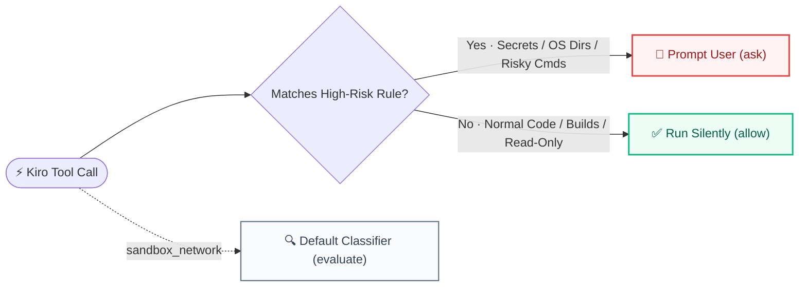

<div align="center">

# ⚡ Kiro Windows Autonomy

<p>
  <b>Rule-Driven User Permissions for Kiro IDE · Windows 11 / PowerShell Steering Ruleset · Automated Regression Suite</b>
</p>
<p>
  <i>Eliminate prompt fatigue on routine builds and read-only checks while guarding credentials, OS directories, and destructive commands</i>
</p>

<p>
  <a href="./README.md"><b>简体中文</b></a> | <b>English</b>
</p>

<p>
  <a href="https://github.com/YOIMIYA66/kiro-windows-autonomy/actions/workflows/ci.yml"></a>
  <a href="./LICENSE"></a>
  <a href="https://github.com/YOIMIYA66/kiro-windows-autonomy"></a>
  <a href="https://github.com/YOIMIYA66/kiro-windows-autonomy"></a>
  <a href="./tests/test_permissions.py"></a>
  <a href="https://github.com/YOIMIYA66/AI-Net-Guard"></a>
</p>

</div>

---

> [!IMPORTANT]
> **Scope & Intent**: This configuration is a **convenience guardrail against accidental agent actions**, NOT a security sandbox or an OS-level security boundary. Pair it with OS permissions and kernel-level network isolation (such as [AI-Net-Guard](https://github.com/YOIMIYA66/AI-Net-Guard)) for real security boundaries.

---

## 🚀 One-Shot AI Setup Prompt

Already using **Kiro** (or another local coding agent)? Copy the prompt below and send it to your agent to **back up your existing `~/.kiro` setup → pull this repo → adapt it to your machine → run tests**:

```text
Please install and adapt the Kiro Windows configuration from https://github.com/YOIMIYA66/kiro-windows-autonomy for my machine in this order:

1. Back up my existing `%USERPROFILE%\.kiro\settings` and `%USERPROFILE%\.kiro\steering` (if present) with a `.bak-YYYYMMDD` suffix and tell me how to roll back.
2. Clone `https://github.com/YOIMIYA66/kiro-windows-autonomy.git` into a temporary directory (e.g. `%USERPROFILE%\.kiro\_upstream-kiro-windows-autonomy`).
3. Copy `settings/permissions.yaml` to `%USERPROFILE%\.kiro\settings\permissions.yaml`:
   - Keep all default guardrail rules.
   - Ask me if I have any local firewall/proxy directories I want protected before uncommenting or adding paths under `fs_write`.
4. Copy `steering/*.md` to `%USERPROFILE%\.kiro\steering\`:
   - Inspect the toolchain actually installed on my machine (Git, Go, Python/uv/conda, Node.js/pnpm, .NET, Java, PSScriptAnalyzer, etc.) and customize `steering/windows-environment.md` accordingly (do not list tools that are missing, and never include any keys, tokens, or proxy node/subscription data).
   - Check with me whether to keep or adjust the reply language rule in `steering/personal-preferences.md` (default is Simplified Chinese).
5. If I use `mcp.json` or need local ignore rules, explain how to adapt `settings/kiroignore.example` and `settings/mcp.example.json` (and note that referencing `${CONTEXT7_API_KEY}` triggers a one-time Kiro approval prompt).
6. Run `python -B -m unittest discover -s tests -v` inside the cloned repo (check/install `pyyaml` in a venv or ask first if missing), validate YAML syntax on `%USERPROFILE%\.kiro\settings\permissions.yaml`, and report backup paths, changed files, and test output.
```

---

## 💡 Key Advantages

| Area | Default Behavior | With **Kiro Windows Autonomy** |
| :--- | :--- | :--- |
| **Prompt Fatigue** | Probabilistic `evaluate` classifier interrupts builds and read-only checks | Blanket `all: allow` keeps **routine coding & read-only diagnostics silent**, pausing only on risky operations |
| **Secret Boundaries** | Opaque classifier heuristics around credentials and OS folders | Explicit `fs_read` + `fs_write` `ask` lists guard keys, tokens, and core Windows directories |
| **Case Bypass Pitfall** | Case-sensitive `shell` matching misses lowercase `set-acl` when `Set-Acl *` is listed | Mirrors standard PowerShell cmdlets in **lowercase** plus `cmd /c` / `/C` wrappers to mitigate known bypasses |
| **Windows Encoding** | Agents mix PS 7 syntax (`??`, `&&`) or write BOM-less UTF-8 scripts that break under CP936 | Enforces **PS 5.1** compatibility, **UTF-8 BOM / ASCII `.bat`**, and `PSScriptAnalyzer` verification |
| **Maintainability** | Hand-editing YAML rules can silently break glob matches | Backed by **9 automated `unittest` regression checks + GitHub Actions CI** |

---

## 📐 How Permissions Work

Kiro resolves tool calls with **`deny > ask > allow > evaluate`** precedence. Normal work passes silently via the baseline rule, while risky actions hit explicit `ask` lists:



---

## 🛡️ What Is Guarded

| Capability | Prompts for Confirmation (`ask`) | Runs Silently (`allow` / `exclude`) |
| :--- | :--- | :--- |
| **Read Secrets (`fs_read`)** | SSH / AWS / Kube / Docker credentials, `.env`, private keys/certs (`.pem` / `.key` / `.pfx` / `.p12`), Git & GitHub CLI credentials | `.env.example`, regular source code and docs |
| **Write OS / Config (`fs_write`)** | All credential paths above, `~/.gitconfig`, `C:/Windows`, `Program Files`, `ProgramData` (plus optional protected dirs) | `.env.example`, workspace code (and e.g. `logs/**` if opted in) |
| **System & Net (`shell`)** | Destructive file ops (`rm` / `Remove-Item` / `robocopy /MIR`), disk/boot/power, registry/ACL (`Set-Acl` / `icacls`), services, firewall/DNS/route edits (incl. lowercase mirrors) | Read-only diagnostics (`Get-*`, `netsh ... show`, `reg query`), builds & tests |
| **Git & Wrappers (`shell`)** | `git reset --hard` / `clean` / `push --force` / `restore --worktree`, `taskkill` / `Stop-Process`, `RunAs` elevation, `powershell -Command/-EncodedCommand`, `cmd /c` & `/C` | `git restore --staged *`, `git status` / `diff` / `commit` |

> [!WARNING]
> **Limitations (Not a Security Sandbox)**
> - **Case-sensitivity**: Lowercase mirrors **mitigate known all-lowercase bypasses**, but Kiro's case-sensitive glob matching still leaves mixed-case variants (such as `sEt-aCl` or `CmD /c`) uncovered.
> - **Static text matching**: Rules inspect command strings only and cannot audit `.ps1` / `.bat` / `.py` script internals, full-path/aliased binaries, or variable indirection (`Set-Acl $k`).
> - **Network capability**: Per [Kiro's permissions documentation](https://kiro.dev/docs/permissions/), `capability: all` **does not include `sandbox_network`**.

---

## 🧭 Steering Rules

Four modular files under [`steering/`](steering/) enforce Windows-aware engineering hygiene:

| File | Scope | Key Rules |
| :--- | :--- | :--- |
| [`engineering-principles.md`](steering/engineering-principles.md) | `always` | Evidence-based diagnosis before fixes; no swallowed errors (`catch {}`, `2>$null`); no faking tests; backup before replacing configs |
| [`powershell-and-batch.md`](steering/powershell-and-batch.md) | `*.ps1` / `*.bat` | Enforces **PowerShell 5.1** syntax; UTF-8 BOM for `.ps1` and ASCII+CRLF for `.bat`; runs `PSScriptAnalyzer` on every edit |
| [`windows-environment.md`](steering/windows-environment.md) | `always` | Prohibits wrapping commands in `pwsh -Command` / `cmd /c`; CP936 console encoding guidance; read-only network/firewall boundaries |
| [`personal-preferences.md`](steering/personal-preferences.md) | `always` | Simplified Chinese replies (keeping code/paths verbatim); plan before touching ≥3 files or system settings; verification report format |

<details>
<summary>📋 View the built-in PowerShell verification commands from <code>powershell-and-batch.md</code></summary>

```powershell
# 1. Syntax parse check
$errs = $null
[void][System.Management.Automation.Language.Parser]::ParseFile('<file>', [ref]$null, [ref]$errs)
$errs

# 2. Lint and PowerShell 5.1 / 7.0 syntax compatibility check
Invoke-ScriptAnalyzer -Path '<file>' -Severity Warning,Error
Invoke-ScriptAnalyzer -Path '<file>' -Settings @{
    IncludeRules = @('PSUseCompatibleSyntax')
    Rules = @{ PSUseCompatibleSyntax = @{ Enable = $true; TargetVersions = @('5.1', '7.0') } }
}
```

</details>

---

## 🛡️ Defense-in-Depth with AI-Net-Guard

Since `permissions.yaml` only inspects Kiro-level commands, pairing it with **[AI-Net-Guard](https://github.com/YOIMIYA66/AI-Net-Guard)** (a zero-resident Windows 11 kernel WFP static firewall & DNS/IPv6 leak shield) provides real kernel-layer network enforcement alongside TUN proxies.

Uncomment these lines under `fs_write` in [`settings/permissions.yaml`](settings/permissions.yaml) to prevent AI agents from altering its firewall scripts or configs:

```yaml
      # Optional: Protect network guard & proxy runtime directories
      # (e.g. if using https://github.com/YOIMIYA66/AI-Net-Guard)
      - "C:/AI-Net-Guard/**"
    exclude:
      - "**/.env.example"
      - "C:/AI-Net-Guard/logs/**"
```

---

## 📦 Manual Installation

> [!TIP]
> The commands below automatically back up your existing `settings` and `steering` folders with a timestamp before copying.

```powershell
# 1. Back up existing configuration
$kiroDir = "$env:USERPROFILE\.kiro"
$stamp = Get-Date -Format "yyyyMMdd-HHmmss"
if (Test-Path "$kiroDir\settings") { Copy-Item -Recurse "$kiroDir\settings" "$kiroDir\settings.bak-$stamp" }
if (Test-Path "$kiroDir\steering") { Copy-Item -Recurse "$kiroDir\steering" "$kiroDir\steering.bak-$stamp" }

# 2. Clone repo and install permissions.yaml + steering rules
git clone https://github.com/YOIMIYA66/kiro-windows-autonomy.git
cd kiro-windows-autonomy
New-Item -ItemType Directory -Force -Path "$kiroDir\settings", "$kiroDir\steering" | Out-Null
Copy-Item .\settings\permissions.yaml "$kiroDir\settings\permissions.yaml"
Copy-Item .\steering\*.md "$kiroDir\steering\"
```

Two quick post-install tweaks:
- **Tailor environment & paths**: Update `## Toolchain` and `## Protected locations` in `%USERPROFILE%\.kiro\steering\windows-environment.md` (and reply language in `personal-preferences.md`), and uncomment any local service paths in `permissions.yaml`.
- **MCP env vars (optional)**: If adapting [`settings/mcp.example.json`](settings/mcp.example.json), set `CONTEXT7_API_KEY` in your environment first; **Kiro prompts for approval the first time an unapproved environment variable is referenced by an MCP server**. See [`settings/kiroignore.example`](settings/kiroignore.example) for ignoring local node DBs/keys.

---

## 📂 Structure & Regression Tests

```text
.
├── .github/workflows/ci.yml           # GitHub Actions CI for regression tests
├── settings/
│   ├── permissions.yaml               # Kiro user-level rule-driven permissions
│   ├── kiroignore.example             # Ignore template for node DBs and private keys
│   └── mcp.example.json               # MCP example with env-var authorization
├── steering/                          # Windows / PowerShell / engineering rules
└── tests/test_permissions.py          # 9 automated rule-matching regression tests
```

Run the regression suite after editing `permissions.yaml` (`PyYAML` required):

```powershell
python -m pip install pyyaml
python -B -m unittest discover -s tests -v
```

---

<div align="center">

**[MIT License](LICENSE)** © 2026 [YOIMIYA66](https://github.com/YOIMIYA66)

If this setup saved you from Kiro prompt fatigue on Windows, consider leaving a ⭐ Star and checking out [AI-Net-Guard](https://github.com/YOIMIYA66/AI-Net-Guard)!

</div>
